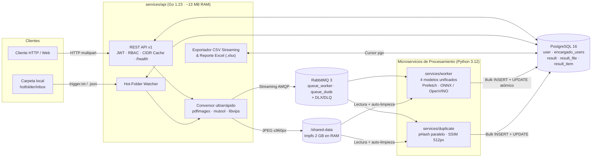

# DESD-API-Rest

Plataforma de microservicios de alto rendimiento para **control de calidad documental mediante visión por computador** y **detección de páginas duplicadas** sobre documentos escaneados (`PDF`, `TIFF`/`Multi-TIFF`, `JPG`, `PNG`, `ZIP`).

Diseñada con una arquitectura políglota orientada a eventos (**Go 1.23 + Python 3.12 + PostgreSQL 16 + RabbitMQ 3 + `tmpfs`**), capaz de procesar **>20 páginas por segundo a través de los 4 modelos simultáneamente** tanto por **API REST** como por **Hot-Folder local** sin latencia de red.

---

## Capacidades principales

| Módulo / Modelo | Función | Resolución | Clases de salida (español) |
|---|---|---|---|
| **`cude`** (`cude_v4`) | Detección de corte de información | `960×960` | `con corte de informacion` / `sin corte de informacion` |
| **`rode`** (`rode_v3`) | Detección de páginas rotadas | `960×960` | `rotado` / `no rotado` |
| **`legibility`** (`legibility_v2`) | Evaluación de legibilidad | `960×960` | `legible` / `no legible` |
| **`tilde`** (`tilde_v2`) | Detección de inclinación | `640×640` | `inclinado` / `no inclinado` |
| **`dude`** (`duplicate`) | Detección de páginas duplicadas | pHash + SSIM (`512px`) | Pares `(pagina1, pagina2, similitud)` |

### Modos de ingesta y control de acceso
- **API REST v1 (Go):** subidas `multipart/form-data` en streaming, autenticación JWT (HS256) con **control de acceso basado en roles (`admin`, `encargado`, `user`)**, control de acceso por IP/CIDR cacheado en memoria, seguimiento de estado en tiempo real, exportación CSV en streaming (`O(1)` en RAM) y **reporte Excel (`.xlsx`)** de archivos procesados y resumen por usuario.
- **Hot-Folder local integrado:** carpeta vigilada (`hotfolder/inbox/`) activada por archivo trigger (`trigger.txt` o `trigger.json`), con auto-exportación atómica de CSV en `hotfolder/results/` y gestión automática de originales (`move`, `delete`, `keep`).

### Roles y visibilidad
- **`user`:** solo puede ver, consultar y exportar sus propios procesamientos.
- **`encargado`:** puede ver, exportar y generar reportes Excel de sus propios procesamientos y los de los usuarios asignados a su cargo (`encargado_users`).
- **`admin`:** acceso global a todos los archivos/procesamientos, gestión de usuarios/roles, asignación de usuarios a encargados, IPs permitidas y reporte Excel global o por usuarios seleccionados.

---

## Arquitectura del sistema



---

## Estructura del repositorio

```text
DESD-API-Rest/
├── docker-compose.yml              # Orquestación con healthchecks, tmpfs y restart policies
├── .env.example                    # Plantilla de variables de entorno
├── services/
│   ├── api/                        # Microservicio API REST + Hot-Folder + Conversor (Go 1.23)
│   │   ├── Dockerfile
│   │   ├── go.mod
│   │   ├── cmd/api/main.go
│   │   └── internal/               # config, db, queue, converter, ingest, export, hotfolder, httpapi
│   ├── worker/                     # Microservicio unificado de inferencia IA (Python 3.12)
│   │   ├── Dockerfile
│   │   ├── worker.py
│   │   ├── services/               # inference_service, database_service, messaging_service (DLQ)
│   │   └── utils/                  # preprocess_image (cv2.dnn.blobFromImage)
│   └── duplicate/                  # Microservicio de detección de duplicados (Python 3.12)
│       ├── Dockerfile
│       ├── main.py
│       ├── services/               # search_service, database_service, messaging_service (DLQ)
│       └── utils/                  # images (pHash + SSIM 512px)
├── models/                         # Modelos ONNX y OpenVINO IR + metadata.yaml
├── hotfolder/                      # Carpetas operativas (inbox, processing, done, failed, results)
├── docs/                           # Arquitectura, referencia API y diagramas Mermaid
├── notebooks/                      # Exportación y experimentación de modelos
└── test/                           # Pruebas de integración
```

---

## Inicio rápido (Quick Start)

### Requisitos
- **Docker** 24+ y **Docker Compose** v2+.

### 1. Configurar variables de entorno
```bash
cp .env.example .env
```
> **Nota en macOS:** AirPlay Receiver ocupa el puerto `5000`; ajusta `API_PORT=5001` en `.env`. En Linux/Windows el puerto por defecto es `5000`.
> **Producción:** cambia `JWT_SECRET_KEY`, `POSTGRES_PASSWORD` y `RABBITMQ_PASS` en `.env`.

### 2. Construir y levantar el stack
```bash
docker compose build
docker compose up -d
```

Al iniciar por primera vez sobre una base vacía, `api` ejecuta automáticamente las migraciones y siembra:
- Usuario administrador inicial: `admin` / `admin`
- IPs permitidas locales: `127.0.0.1`, `::1`, `172.16.0.0/12`, `192.168.0.0/16`

### 3. Verificar salud de los servicios
```bash
docker compose ps
curl http://localhost:${API_PORT:-5000}/health
# {"postgres":true,"rabbitmq":true,"status":"ok"}
```

### 4. Primera prueba rápida (API REST)
```bash
# 1. Obtener token JWT
TOKEN=$(curl -s -X POST http://localhost:5000/api/v1/auth \
  -H "Content-Type: application/json" \
  -d '{"username":"admin","password":"admin"}' | jq -r '.access_token')

# 2. Enviar un PDF a los 4 modelos
curl -X POST http://localhost:5000/api/v1/worker \
  -H "Authorization: Bearer $TOKEN" \
  -F "models=cude,rode,legibility,tilde" \
  -F "task_id=prueba_01" \
  -F "files=@documento.pdf"

# 3. Consultar progreso
curl -H "Authorization: Bearer $TOKEN" http://localhost:5000/api/v1/task/prueba_01

# 4. Descargar CSV en streaming (normal o no_tecnico)
curl -H "Authorization: Bearer $TOKEN" \
  "http://localhost:5000/api/v1/export/prueba_01?formato=no_tecnico" -o resultado.csv

# 5. Descargar reporte Excel (.xlsx) de archivos procesados (admin o encargado)
curl -H "Authorization: Bearer $TOKEN" \
  "http://localhost:5000/api/v1/report/excel" -o reporte_archivos.xlsx
```

### 5. Pruebas automatizadas E2E (RBAC y reporte Excel)
```bash
API_BASE_URL=http://localhost:${API_PORT:-5000} python3 test/test_rbac.py
```

---

## Rendimiento medido (Docker local)

Pruebas end-to-end sobre los 4 modelos simultáneos (`cude`, `rode`, `legibility`, `tilde`) con `tmpfs`, `mutool`/`pdfimages`/`libvips`, pipeline prefetch de 3 etapas y PostgreSQL 16:

| Escenario | Conversión | Tiempo total (`COMPLETED`) | Rendimiento |
|---|---|---|---|
| **PDF 50 págs × 4 modelos** (`200` inferencias, `mutool` paralelo a `960px`) | `0.038 s` (`0.76 ms/pág`) | **`2.305 s`** | **`21.7 págs/s`** (`0.046 s/pág`) |
| **Multi-TIFF 10 págs · 54.9 MB × 4 modelos** (`40` inferencias, `libvips` SIMD) | `0.100 s` (`10 ms/pág`) | **`0.598 s`** | **`16.7 págs/s`** (`0.060 s/pág`) |
| **Duplicados · 5 págs escaneadas** (`10` pares, `pdfimages` + SSIM `512px`) | `0.010 s` (`2 ms/pág`) | **`0.106 s`** | **`47.2 págs/s`** |
| **Hot-Folder local · 5 págs × 4 modelos + 2 CSVs + borrado** | `0.053 s` | **`0.394 s`** | **`12.7 págs/s`** |
| **Exportación HTTP CSV en streaming (200 filas)** | — | **`1.4 ms`** | Memoria constante `O(1)` |
| **Memoria RAM de `api` (Go REST + Hot-Folder)** | — | **`~13 MiB`** | — |

---

## Operación y escalado

### Escalado horizontal de workers
En servidores con muchos núcleos de CPU puedes levantar múltiples réplicas de `worker` o `duplicate` sin cambiar configuración:
```bash
docker compose up -d --scale worker=2 --scale duplicate=2
```
*(Ajusta `INFERENCE_NUM_THREADS` en `.env` si corres varias réplicas en el mismo host para evitar contención de hilos.)*

### Colas y Dead-Letter Queues (RabbitMQ)
- Consola web de administración: `http://localhost:15672`
- Colas activas: `queue_worker`, `queue_dude`
- Colas de mensajes fallidos (exchange `desd.dlx`): `queue_worker_dlq`, `queue_dude_dlq`

### Endpoints de servicios locales
- **API REST:** `http://localhost:${API_PORT:-5000}`
- **Healthcheck:** `http://localhost:${API_PORT:-5000}/health`
- **RabbitMQ Management:** `http://localhost:15672`
- **PostgreSQL:** `localhost:5432`

---

## Documentación detallada

- **Arquitectura y decisiones técnicas:** [docs/ARCHITECTURE.md](docs/ARCHITECTURE.md)
- **Referencia completa de la API REST v1:** [docs/api/README.md](docs/api/README.md)
- **Microservicio API & Conversor (Go):** [services/api/README.md](services/api/README.md)
- **Microservicio Worker IA (Python):** [services/worker/README.md](services/worker/README.md)
- **Microservicio Duplicados (Python):** [services/duplicate/README.md](services/duplicate/README.md)
- **Guía de uso del Hot-Folder local:** [hotfolder/README.md](hotfolder/README.md)
