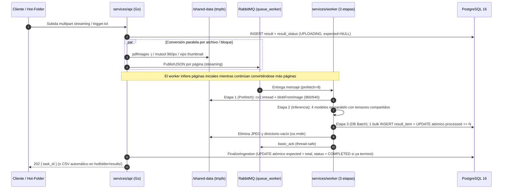
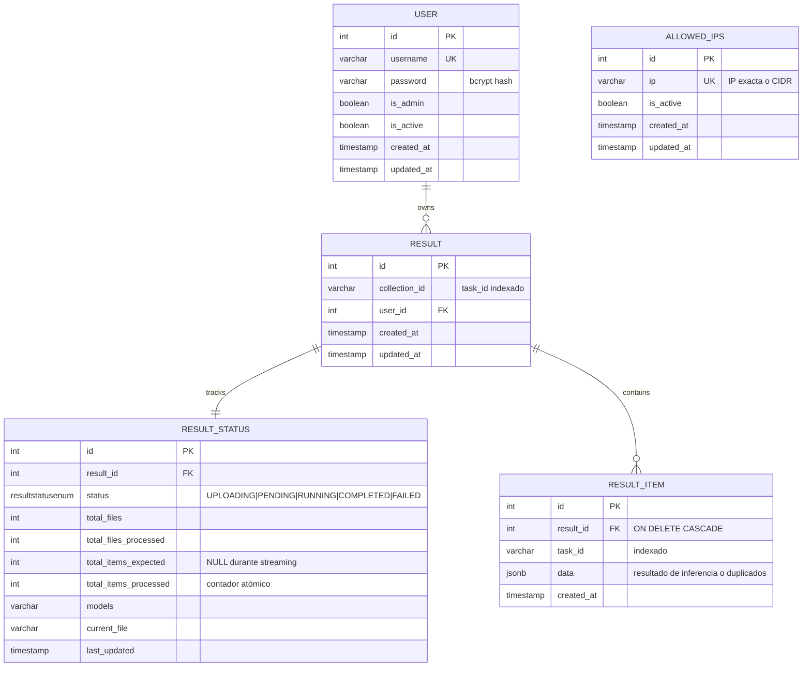

# Arquitectura del Sistema — DESD-API-Rest

Este documento detalla el diseño técnico, el flujo de datos, el modelo de persistencia y las decisiones de arquitectura que permiten procesar documentos a alta velocidad con baja huella de recursos.

---

## 1. Visión general de componentes

El sistema consta de **5 contenedores** coordinados por Docker Compose:

| Servicio | Tecnología | Rol | Estado / Escalado |
|---|---|---|---|
| `api` | **Go 1.23** (`net/http`, `pgx/v5`, `amqp091-go`) | API REST v1, Auth JWT, CIDR allowlist, Hot-Folder local, conversión de documentos y exportación CSV en streaming | Stateless HTTP + watcher singleton (`HOTFOLDER_ENABLED`) |
| `worker` | **Python 3.12** (`onnxruntime`, `openvino`, `opencv`, `SQLAlchemy`) | Inferencia paralela de los 4 modelos (`cude`, `rode`, `legibility`, `tilde`) con prefetch de 3 etapas | Escalable horizontalmente (`--scale worker=N`) |
| `duplicate` | **Python 3.12** (`imagehash`, `scikit-image`, `opencv`, `SQLAlchemy`) | Detección de páginas duplicadas (pHash paralelo + SSIM `512px`) | Escalable horizontalmente (`--scale duplicate=N`) |
| `postgres` | **PostgreSQL 16** | Fuente única de verdad: usuarios, IPs, tareas, estados atómicos y resultados (`JSONB`) | Volumen persistente `postgres-data` |
| `rabbitmq` | **RabbitMQ 3 Management** | Bus de mensajería duradero con Dead-Letter Exchange (`desd.dlx`) | Colas `queue_worker`, `queue_dude` + `*_dlq` |

Almacenamiento transitorio:
- **`/shared-data` (`tmpfs` 2 GB en RAM):** volumen compartido en memoria entre `api`, `worker` y `duplicate`. Elimina I/O físico de disco para imágenes intermedias; cada archivo se elimina automáticamente al confirmarse su escritura en PostgreSQL.

---

## 2. Flujo de procesamiento en streaming

---

## 3. Optimizaciones clave del pipeline

### 3.1 Motor de conversión inteligente (`services/api/internal/converter`)
La conversión elige automáticamente el camino más rápido por tipo de documento sin perder exactitud visual:
1. **PDF escaneado con JPEGs embebidos (sin rotación):** detectado mediante `pdfinfo` + `pdfimages -list`. Usa `pdfimages -j` para extraer los JPEGs crudos sin rasterizar (**0 decodificación/recodificación**).
2. **PDF vectorial, texto o mixto:** divide las páginas en bloques (`CONVERTER_PDF_CHUNK_SIZE=8`) y ejecuta `mutool draw -q -w 960 -h 960` en goroutines paralelas (con fallback automático a `pdftoppm -scale-to 960`). Cada bloque publica inmediatamente sus páginas en RabbitMQ.
3. **TIFF y Multi-TIFF:** lee el conteo con `vipsheader -f n-pages` y convierte cada página en paralelo con `vips thumbnail "archivo.tif[page=N]" ... 960` usando `libjpeg-turbo` SIMD (**sin `tiffsplit` ni archivos temporales**).
4. **Imágenes JPG/PNG grandes (>300 KB o PNG):** `vips thumbnail` con shrink-on-load DCT directo a `960px`; JPEGs pequeños se copian directo a `tmpfs`.

### 3.2 Worker multi-modelo con pipeline solapado de 3 etapas (`services/worker`)
- **Decodificación y tensores compartidos:** una página se lee y decodifica del `tmpfs` **una sola vez**. Los modelos `cude`, `rode` y `legibility` comparten exactamente el mismo tensor `1×3×960×960` generado con `cv2.dnn.blobFromImage` (C++/SIMD, sin copias `float64`), y `tilde` recibe `1×3×640×640`.
- **Etapa 1 (Prefetch threads):** decodifica y preprocesa la página `N+1` mientras la etapa 2 infiere la página `N`.
- **Etapa 2 (Inferencia paralela):** ejecuta todos los modelos solicitados en paralelo (ONNX Runtime / OpenVINO liberan el GIL). En CPUs Intel usa OpenVINO IR; en ARM64/otros usa ONNX Runtime (`ORT_ENABLE_ALL`, soporte opset 22).
- **Etapa 3 (Escritor PostgreSQL en micro-lotes):** agrupa hasta `WORKER_DB_BATCH_SIZE` páginas en una sola transacción (1 bulk `INSERT` + 1 `UPDATE` atómico), elimina las imágenes de `tmpfs` y envía `basic_ack` thread-safe a RabbitMQ.

### 3.3 Sincronización atómica sin condiciones de carrera
Para soportar streaming real (el worker puede terminar antes o después de que la API acabe de convertir el último PDF) sin `SELECT COUNT(*)`:
- Mientras se ingieren archivos, `result_status.total_items_expected` permanece `NULL`.
- Cada commit del worker incrementa atómicamente `total_items_processed = total_items_processed + :added` y pasa a `COMPLETED` solo si `total_items_expected IS NOT NULL AND total_items_processed >= total_items_expected`.
- Al terminar la ingesta, `api` fija `total_items_expected = :expected` y verifica atómicamente en la misma sentencia `UPDATE ... RETURNING` si `total_items_processed >= :expected` para marcar `COMPLETED` de inmediato si los workers ya acabaron.

### 3.4 Tolerancia a fallos con Dead-Letter Queues (DLQ)
- Exchange `desd.dlx` (`direct`, durable) enlazado a `queue_worker_dlq` y `queue_dude_dlq`.
- Si una página llega corrupta o falta un archivo, el worker hace `basic_nack(requeue=False)`, enrutando el mensaje a la DLQ para auditoría/reintento sin detener el procesamiento del resto de la cola.

---

## 4. Modelo de datos (PostgreSQL 16)

---

## 5. Registro de decisiones de arquitectura (ADR)

| Decisión | Alternativa descartada | Justificación |
|---|---|---|
| **PostgreSQL único (`JSONB`)** | MongoDB + PostgreSQL | Elimina un motor de BD completo, evita escrituras duales, simplifica respaldos y brinda transacciones ACID entre resultados y estado. |
| **API + Hot-Folder + Conversor en Go** | Flask + microservicio gRPC aparte | Reduce RAM de ~115 MiB a ~13 MiB, elimina serialización de megabytes por gRPC y habilita streaming real en subidas y exportaciones CSV. |
| **Worker único multi-modelo en Python** | 4 contenedores `worker_*` separados | Elimina 75% de lecturas/decodificaciones JPEG repetidas, comparte tensores `960×960`, permite limpieza atómica de temporales y escala con `--scale worker=N`. |
| **`/shared-data` en `tmpfs` (single-host)** | MinIO / S3 local | Latencia de memoria (~0.05 ms vs 5–25 ms HTTP+disco por página) y 0 RAM fija extra. Si en el futuro se migra a Kubernetes multi-nodo, puede sustituirse por un adaptador S3/MinIO. |
| **SSIM escalado a `512px` en `duplicate`** | SSIM a resolución completa | Acelera detección de duplicados ~18× preservando la similitud estructural del documento. |
